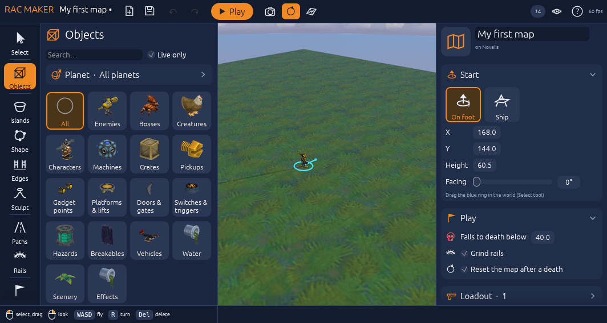
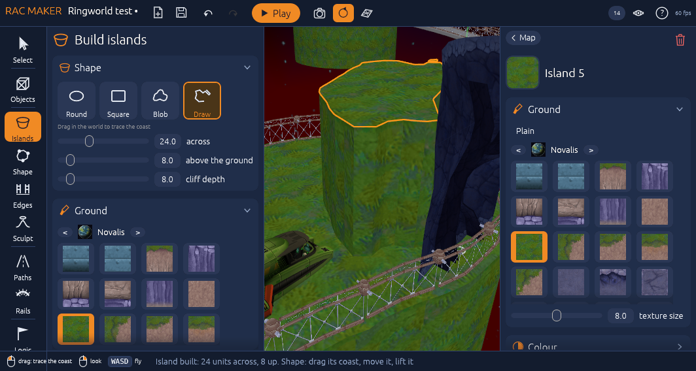
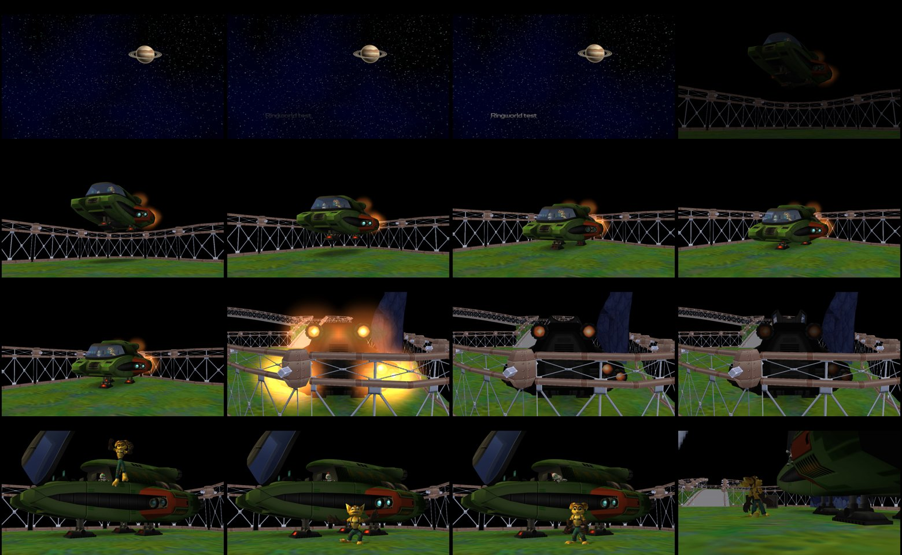

# RAC Maker for ReRAC

Make your own Ratchet & Clank levels and play them in [ReRAC](https://github.com/re-rac/rerac), with Ratchet's full moves, gadgets and weapons. Build islands, place any object or enemy from all 18 planets, add grind rails, paths, rules and a sky, then press **Play**: Ratchet's ship flies to your planet and lands.

**This is a test build.** Things will break; please tell me what does.

## Install (Windows)

You need ReRAC set up first: the [ReRAC Launcher](https://github.com/re-rac/rerac-launcher) with Ratchet & Clank installed from your own disc image (NTSC-U). RAC Maker uses that same game data; nothing from the game is included here.

1. Download **RAC-Maker-0.1.0.zip** from [Releases](https://github.com/thrivetoday/rac-maker-for-rerac/releases/latest) and unzip it.
2. Double-click **install.bat**. It finds your ReRAC folder by itself and prepares the object pictures from your game (about 30 seconds).
3. Start **RAC Maker** from your desktop.

To remove it: run **uninstall.bat**. Your maps stay in `Documents\RAC Maker`.

The install adds RAC Maker as one more ReRAC version (`0.3.6 + RAC Maker`) and does not change your normal ReRAC or your saves. It also adds **ReRAC Launcher with RAC Maker** to the Start menu: a preview of the launcher with a RAC Maker tile (map library, import, export). You don't need it to make or play maps.

## Make a level

- **F1** opens the help in the editor; **Guide** in the main menu opens the full guide.
- **Islands**: click to build one, drag to size it, or pick **Draw** and trace any coast with the mouse.
- **Objects**: pick a category, click an object, click in the world. **Live only** shows the objects that work away from their home planet.
- **Rails**, **Paths**, **Logic** (zones and rules), **World** (sky, fog, light, music and the planet you fly to).
- **F5** plays the level; F5 again goes back to the editor. Everything you broke comes back.

## Share a level

Main menu → pick a map → **Share**. You get one small `.racmap` file (about 300 KB, with its picture) to send to someone. They open it with **Import…** in the main menu: it finds `.racmap` files in Downloads and on the Desktop by itself.

## Feedback

Post in the ReRAC Discord, or open an issue here. Most useful: what you did, what happened, and the map (Share it and attach the `.racmap`). If the editor closed by itself, the crash log is in `%LOCALAPPDATA%\rerac\logs`.

## Source and credits

- RAC Maker is built on ReRAC by the ReRAC contributors (ISC license): https://github.com/re-rac/rerac
- Editor source: branch [`rac-maker`](https://github.com/thrivetoday/rerac/tree/rac-maker) of my ReRAC fork. The preview launcher is the [ReRAC Launcher](https://github.com/re-rac/rerac-launcher) (ISC) with a RAC Maker tile added; its source will follow.
- This build also has my [DualSense support](https://github.com/thrivetoday/dualsense-for-rerac) (rumble, adaptive triggers). Gadgetron Movement System idea: roxas997.
- Ratchet & Clank belongs to Sony Interactive Entertainment and Insomniac Games. Maps hold no game assets, only references; you need your own copy of the game.
